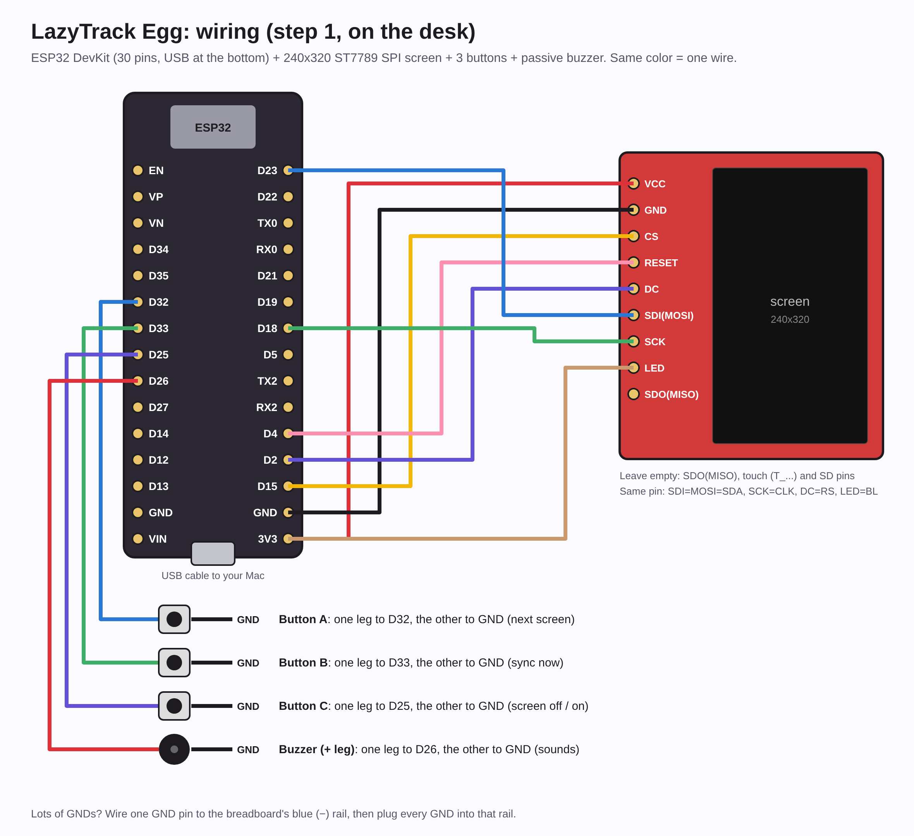

# LazyTrack Egg (step 1: on the desk)

Your Mochi on a little screen: same look, HP, level, age, drunk/high/coughing, and what you're doing.
It logs into your LazyTrack account over WiFi and reads your friend card every minute.

## What you need

- ESP32 dev board (the one you have) + USB cable
- 240x320 SPI color screen (the one you have)
- 3 small push buttons (6x6 mm), a passive buzzer, a breadboard and jumper wires

## Wiring

| Screen pin | ESP32 pin |
|---|---|
| VCC | 3V3 |
| GND | GND |
| CS | GPIO 15 (D15) |
| RESET / RST | GPIO 4 (D4) |
| DC / RS | GPIO 2 (D2) |
| SDI / MOSI / SDA | GPIO 23 |
| SCK / CLK | GPIO 18 |
| LED / BL | 3V3 (always on) |
| SDO / MISO | not needed |

| Part | ESP32 pin |
|---|---|
| Button A (pet / back) | GPIO 32, other leg to GND |
| Button B (menu / OK) | GPIO 33, other leg to GND |
| Button C (next / screen off) | GPIO 25, other leg to GND |
| Buzzer + | GPIO 26 (buzzer - to GND) |

| Touch pin (screen) | ESP32 pin |
|---|---|
| T_CLK | GPIO 14 |
| T_CS | GPIO 21 |
| T_DIN | GPIO 13 |
| T_DO | GPIO 35 |
| T_IRQ | GPIO 27 |

Buttons need no resistors: the ESP32's own pull-ups are used. The SD card pins stay unconnected.
Touch is optional: at start the egg checks for the touch chip; without the T_ wires it just uses the buttons (Info shows "Touch: not connected"). Don't touch the screen while it starts.

**Touch:** the first time you touch the screen it shows 3 crosses to tap (so it knows where your finger is; saved).
Then: tap to pick something, tap it again to open it, tap the top bar to go back. On Home, tap Mochi to pet,
anywhere else for the menu. In Friends, tap their Mochi to poke. To set it up again, hold a finger on the Info screen for 3 s.

## Arduino IDE, step by step

1. **Board support:** Arduino IDE → Settings → "Additional boards manager URLs", add
   `https://espressif.github.io/arduino-esp32/package_esp32_index.json`. Then Tools → Board → Boards Manager,
   search **esp32** (by Espressif) and install it.
2. **Libraries:** Tools → Manage Libraries, install **GFX Library for Arduino** (by Moon On Our Nation), **ArduinoJson** (by Benoit Blanchon) and **NimBLE-Arduino** (by h2zero, for Bluetooth).
3. **Open** `device/LazyTrackEgg/LazyTrackEgg.ino`.
4. **Your secrets:** copy `secrets.example.h` to `secrets.h` (same folder) and fill in your WiFi and LazyTrack email + password.
   `secrets.h` is ignored by git, so it never goes to GitHub.
5. **Your screen chip:** the sketch is set to ST7789 (what most 2.0" 240x320 screens use). For an ILI9341, switch the two lines at the top.
6. Tools → Board → **ESP32 Dev Module**, Tools → **Partition Scheme → "Minimal SPIFFS (1.9MB APP with OTA/190KB SPIFFS)"**
   (the sketch is too big for the default one since Bluetooth came in), Tools → Port → the USB port that appears when you plug it in. Press **Upload** (→).
   If it says "Connecting....___" for a long time, hold the **BOOT** button on the ESP32 until it starts writing.
7. Tools → Serial Monitor at 115200 shows what it's doing if something's off.

## Playing with it

| | A | B | C |
|---|---|---|---|
| **Home** (your Mochi) | pet Mochi (hearts); feed him when he's hungry | menu | screen off (any button wakes it). Right after logging: undo |
| **Menu** | back | open | next |
| **Log** | back | log it (Mochi reacts right away) | next |
| **Friends** | back | poke them (their egg buzzes, their app plays a sound) | next friend |
| **Today** | back | yesterday vs today for the highlighted stat | next stat |
| **Yesterday vs today** | back | back | next stat |

- **Log** lists the habits you track in LazyTrack. A log reaches LazyTrack within a minute, while LazyTrack runs on
  your computer. Without WiFi, logs wait on the egg and go out once it's back online.
- **Friends** shows each friend's Mochi, HP, whether they're drunk/high, online or last seen, and what they're doing.
- When a friend pokes you, waves or sends love (from their egg or the app), the egg wakes up, buzzes and shows who.
- One-time setup for logging and pokes: run `supabase/egg.sql` in Supabase (see `supabase/README.md`).
- The sketch is getting big: if Arduino says it's too large, pick Tools → Partition Scheme → **Huge APP (3MB No OTA)**.

## If something's off

- **White or black screen:** wiring, or the wrong chip setting (try the other one).
- **Colors look like a photo negative:** set `SCREEN_INVERT` at the top to `true`.
- **"Login failed":** the email/password in `secrets.h`. **"No card yet":** open LazyTrack on your computer once while logged in.
- The bottom line shows what you're doing (or the status); Menu → Info has WiFi, IP and the last sync (B there syncs now).

Compiled and checked with ESP32 board package 3.3.12, GFX Library for Arduino 1.6.9 and ArduinoJson 7.4.2.

## No WiFi? Bluetooth through your phone, or fully offline

- **Through your iPhone:** when the egg has no WiFi, the LazyTrack iPhone app keeps it online over Bluetooth, even
  with the app closed (like a watch). Setup tab → "LazyTrack Egg (Bluetooth)" → on. The first time, iOS asks to
  pair: tap **Pair**. The phone only passes the egg's requests to the LazyTrack server (encrypted link), and gives it
  the time. Info on the egg says "Online via: phone (Bluetooth)". Rebuild the iPhone app once (./setup.sh, ▶ in Xcode).
- **Fully offline:** LazyTrack sends the egg today's and tomorrow's meal times and your sleep window. With no
  connection at all, the egg keeps Mochi's day going on its own clock: he gets hungry, A feeds him, he sleeps at
  your usual time. Logs and meals wait on the egg and go out when it's back online.

## Songs

An old handheld-game sound on the buzzer: Mochi sings his little song now and then (every 1-3 hours while you're
around), when you pet him 3 times within 20 seconds, a lullaby when he falls asleep and a jingle when he wakes up.
Little notes float up from his head while he sings.
