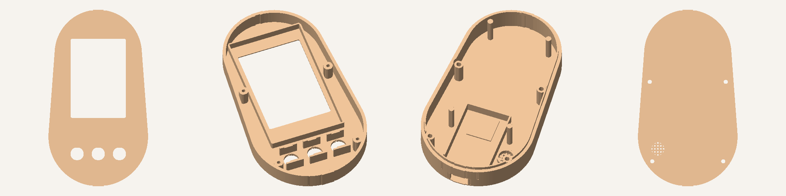

# LazyTrack Egg: the case

An egg-shaped case (80 × 142 × 31 mm) for the 2.8" red-board screen, a 38-pin ESP32 (USB-C), three 12 × 12 mm buttons and a 10 mm buzzer.
It's powered over USB-C for now. There's room behind the screen for a battery later.

## Files

Run `python3 egg_case.py` (needs only numpy) to write the STL files into `stl/`. `python3 render.py` redraws the preview.
All sizes are at the top of `egg_case.py`, so the case can be adjusted to your parts.

| File | What it is | Print it |
|---|---|---|
| `test_face.stl` | Only the face: window and button holes | First, about 30 min, to check the screen and buttons line up |
| `front_shell.stl` | Face, screen pocket, button pockets, screw bosses | Face down on the bed |
| `back_shell.stl` | Back, ESP32 cradle, buzzer grille, USB-C opening, screen posts | Back down on the bed |
| `button_caps.stl` | 3 button caps | Flat flange down |

## Printing (Elegoo Centauri Carbon, PLA)

- 0.2 mm layers, 3 walls, 15 % infill (gyroid), no supports, no brim.
- The parts are already in the right orientation, so drop them on the plate as they are.
- Textured PEI plate: the face gets a nice matte texture.

## What else you need

- 4 × M3 × 20 screws. They self-tap into the PLA bosses; M3 × 16 also works. Without screws, the lip holds the shells together, and a drop of glue makes it permanent.
- Double-sided foam tape: one piece under the ESP32, and small dots on top of the 4 screen posts.
- Thin wire and solder: inside the case the jumper-wire plugs are too tall, so solder wires straight to the pins.

## Assembly

1. **Buttons:** drop the caps into the face holes from the inside, then press each switch into its pocket (knob on the cap) until it clicks under the small lip. The legs go to the open sides. A dot of hot glue on the back keeps them solid.
2. **Screen:** glass towards the window, **pin header at the top** (the narrow end of the egg). It sits in the rim.
3. **ESP32:** components facing the back shell, pins pointing up. Put foam tape on the ESP32 module (the metal can) and press it onto the raised pad, USB-C into the opening at the bottom.
4. Solder the wires (same pins as in `../README.md`). Use buttons 32 / 33 / 25 and buzzer 26 as before.
5. Put foam dots on the screen posts, close the shells (the lip goes inside the front) and screw them together from the back.

If the screen sits loose, add a thicker foam dot. If the shells don't close, the posts are too long: cut 1 mm off.
